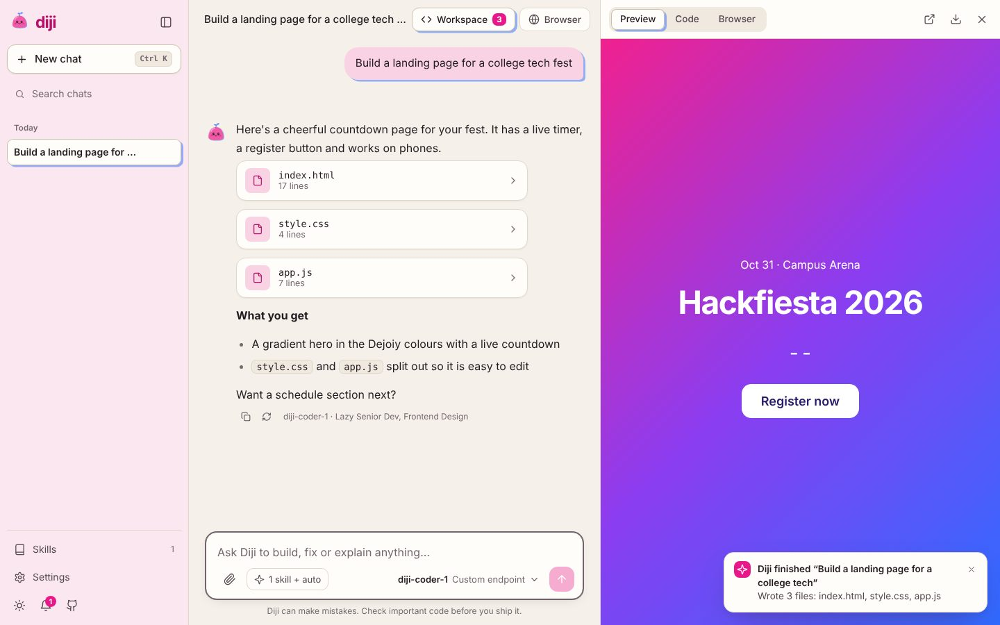
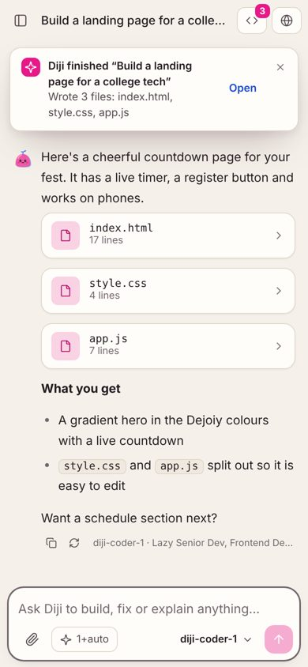
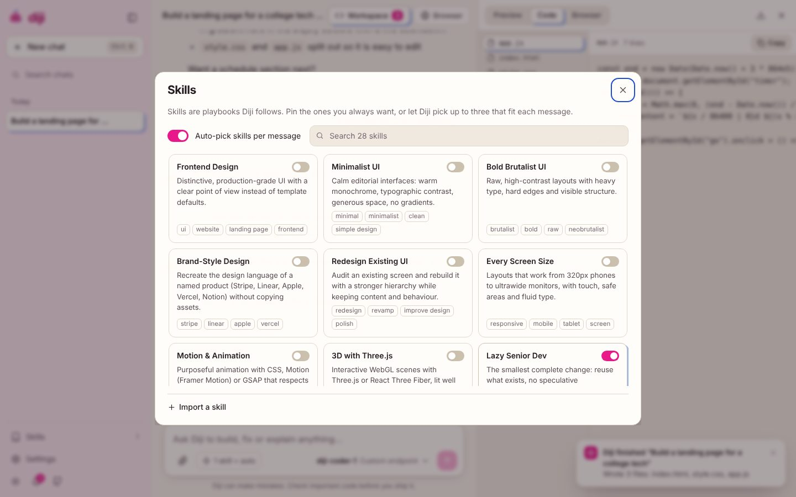
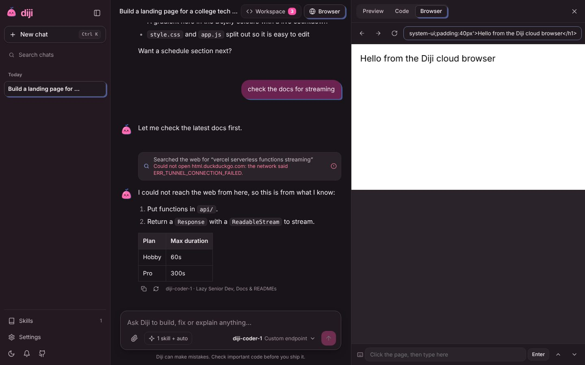
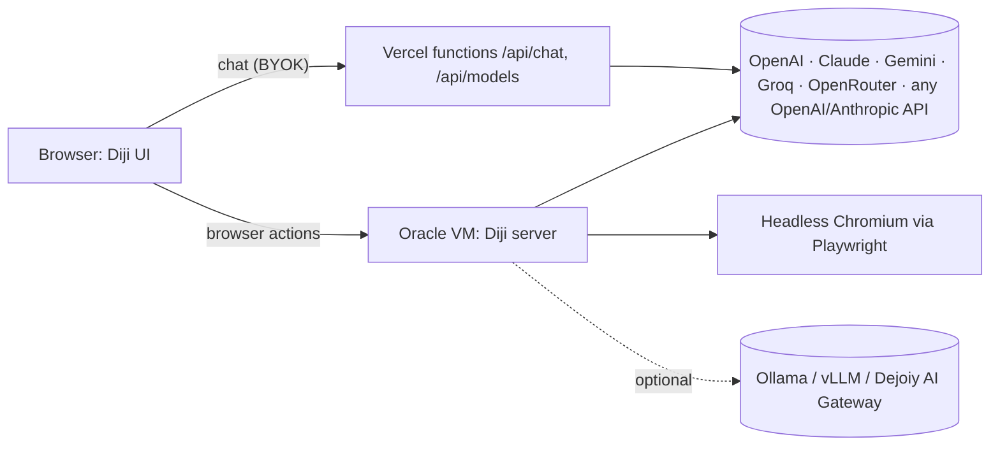

<div align="center">


# Diji — the joyful coding agent

**An open coding agent by [Dejoiy](https://dejoiy.com).** Works with every major AI provider and any open-source model, writes real files with a live preview, follows 28 built-in skills, and drives its own cloud browser.

[**Deploy the app on Vercel**](https://vercel.com/new/clone?repository-url=https%3A%2F%2Fgithub.com%2Fpartnersdejoiy-hash%2Fdiji-coding-agent&root-directory=web&project-name=diji) · [Run the server on Oracle Cloud (free)](#2-cloud-server-on-oracle-always-free)

</div>



## What it does

- **Any model, your key.** Bring your own key for OpenAI, Anthropic Claude, Google Gemini, Groq, OpenRouter, Mistral, DeepSeek, xAI Grok, Together, Cerebras and Hugging Face, or plug in **any** OpenAI- or Anthropic-compatible endpoint (Muse, Azure, Fireworks, your company's model). Self-hosted open models via Ollama, LM Studio, vLLM or llama.cpp. **Diji Free** works with no key at all. "Fetch models" lists whatever the provider offers today.
- **A real coding agent loop.** Diji writes complete files into a workspace, sees the current files on every turn, and edits by rewriting them. Tool calls are plain-text tags, so the agent works even on models without native function calling.
- **Live preview + code + ZIP.** Multi-file web apps run instantly in a sandboxed preview (local CSS/JS inlined), open in a new tab, or download as a ZIP.
- **Cloud browser.** A headless Chromium on your server lets Diji search the web and read docs, and lets you click, type and scroll a real page from the panel.
- **28 skills.** Playbooks for frontend design, minimalist/brutalist/brand-style UI, redesigns, responsive layouts, motion, Three.js, lazy-senior-dev coding, full output, debugging, code review, React/Next.js, backend APIs, databases, testing with Playwright, security, performance, accessibility, deploying to Vercel/Oracle/AWS, git, docs, charts, PDF/Word/Excel/PowerPoint, Python automation, AI apps, DSA interview prep and video prompts. Diji auto-picks up to three per message, you can pin your favourites, and you can **import any open-source `SKILL.md`** by link or paste.
- **Notifications.** Toasts, a notification center, and system notifications when Diji finishes while you are in another tab.
- **Every screen.** Built and tested from 320px phones to 1440px+ desktops, light and dark, keyboard and screen-reader friendly, reduced-motion aware.
- **Private by design.** Chats, files and keys stay in your browser. Keys only travel inside the request to the provider they belong to, through a stateless proxy that never logs them.

| Phone | Skills | Cloud browser |
|---|---|---|
|  |  |  |

## Architecture



```
web/                 Static UI + Vercel functions (no build step)
  index.html, app.css
  js/                app shell, agent loop, workspace, cloud browser client, skills, settings, notifications, mascot
  shared/catalog.js  provider catalog shared by UI and proxy
  api/               chat + models proxy (Web Request/Response handlers)
  skills/            28 built-in SKILL.md playbooks + index.json
server/              Oracle server: cloud browser + chat proxy + serves the UI
  index.js, browser.js, Dockerfile, deploy/ (compose, Caddy, setup script), test/
```

## Quick start (local)

Needs Node 20+.

```bash
git clone https://github.com/partnersdejoiy-hash/diji-coding-agent
cd diji-coding-agent/server
npm install
npm run setup      # downloads Chromium for the cloud browser
npm start          # http://localhost:8787  (UI + chat proxy + cloud browser)
```

Open http://localhost:8787, then **Settings → Cloud server** → `http://localhost:8787` to turn on the browser. For local Ollama models start with `ALLOW_LOCAL_LLM=1 npm start` and choose **Send chats through: My Diji server**.

Run the tests (streaming, BYOK errors, key redaction, SSRF blocking, real Chromium):

```bash
cd server && npm test
```

## Deploy

### 1. App on Vercel

Click **Deploy the app on Vercel** above, or import the repo in Vercel and set **Root Directory = `web`**. No build command, no env vars needed. Optional env vars:

| Variable | What it does |
|---|---|
| `DIJI_FREE_BASE_URL`, `DIJI_FREE_API_KEY`, `DIJI_FREE_MODEL` | Point "Diji Free" at your own endpoint (e.g. an OpenRouter key with free models, or your Dejoiy AI Gateway). Defaults to a public keyless endpoint. |
| `CORS_ORIGIN` | Restrict which sites may call the API (default `*`). |

To give every visitor the cloud browser automatically, put your server URL in `web/config.js`.

### 2. Cloud server on Oracle Always Free

1. Create an **Always Free** Ubuntu VM in Oracle Cloud (Ampere A1 ARM or AMD micro).
2. In the console, open TCP **80** and **443**: Networking → Virtual cloud networks → your VCN → Security Lists → Add Ingress Rules (source `0.0.0.0/0`).
3. SSH in and run:

```bash
curl -fsSL https://raw.githubusercontent.com/partnersdejoiy-hash/diji-coding-agent/main/server/deploy/oracle-setup.sh | CORS_ORIGIN=https://your-app.vercel.app bash
```

The script installs Docker, opens the VM firewall, and starts Diji behind Caddy with automatic HTTPS on a free `<your-ip>.sslip.io` hostname (or your own domain via `DIJI_DOMAIN`). It prints the **server URL** and an **access token**: paste both into Diji → Settings → Cloud server.

| Server variable | Default | Purpose |
|---|---|---|
| `DIJI_SERVER_TOKEN` | random | Required header `x-diji-token` for all API calls |
| `CORS_ORIGIN` | `*` | Your Vercel URL |
| `DIJI_MAX_BROWSERS` | `4` | Concurrent browser sessions |
| `ALLOW_LOCAL_LLM` | `0` | Allow http/private model URLs (self-hosted models on a trusted box) |

## How the agent works

1. Diji builds a system prompt from its base instructions, the active skills and the current workspace files.
2. The reply streams in. Fenced blocks with `file=path` become workspace files; `<diji-search query="…"/>` and `<diji-browse url="…"/>` become tool calls.
3. Tools run on the cloud browser, results go back to the model as the next message, and the loop continues (up to 6 steps).

## Security notes

- The proxy blocks private, loopback and cloud-metadata addresses for custom model URLs and inside the cloud browser (including redirects and sub-requests).
- Upstream error messages are passed through with anything that looks like a key redacted.
- Model output is rendered as escaped Markdown; the live preview runs in a sandboxed iframe without same-origin access.

## License

MIT © Dejoiy. Built-in skills are original playbooks written for Diji. Imported skills keep their own licenses.
